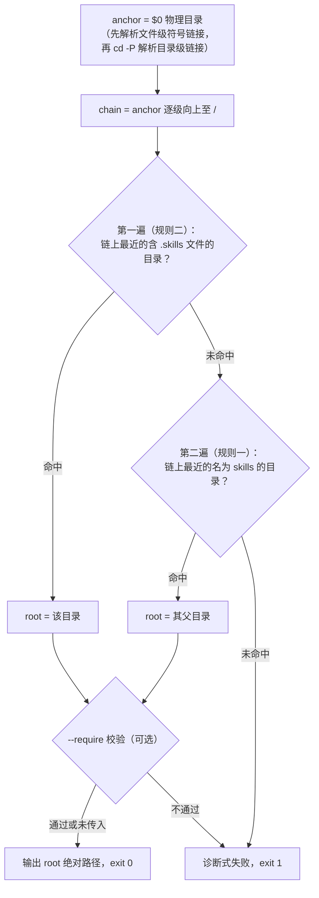

# Skill 伴生内容根目录解析契约

本文约定 skill 脚本定位伴生内容仓库根目录的部署契约、识别规则、优先级与失败语义，是实现 `get-content-root.sh` 的规范依据。

## 1. 背景与动机

### 1.1 问题：相对引用

skill 内的脚本需要引用同仓库中的规范内容。调用时的 CWD 不可预测，相对路径不可用；把规范内容复制进 skill 又与"规范持续更新"矛盾。需要一个确定性的解析机制，把"skill 内的逻辑引用"解析为"内容仓库根的绝对路径"。

### 1.2 背景：规范持续更新与符号链接安装

伴生内容持续演进，因此内容必须留在源仓库内，skill 只持引用、不持内容。安装方式为符号链接：skill 的物理文件留在源仓库内，向 Agent 约定的技能目录建立符号链接。解析脚本的任务是从自身物理位置出发，找到内容仓库根。

## 2. 目标与非目标

### 2.1 目标

- 解析结果确定：输出 = f(脚本物理位置, 声明参数)，与调用时的 CWD 无关；
- 零解析器专属机器配置：根识别不依赖环境变量、注册表或逐机维护的路径配置；每个 Agent 约定目录仍需按部署方式建立指向源 skill 的符号链接；
- 渠道无关：clone、符号链接、zip 导出等分发方式下行为一致；
- 机制通用：解析机制不绑定具体内容目录或文件名，调用方通过参数声明要验证的内容路径。

### 2.2 非目标

- 不支持复制安装（物理文件拷出仓库），这不是能力缺口，是契约排除项（见 3.2）；
- 不做基于 CWD 的探测（见 8.2）；
- 不依赖 `.git`（见 8.1）；
- 不做全盘搜索或任意目录猜测。

## 3. 部署契约

### 3.1 同仓原则

skill 的物理文件必须位于内容仓库内，标准收纳位置为仓库根下的 `skills/` 子目录。向技能目录的安装必须是符号链接，链接粒度二选一：

- **目录级**：链接指向 skill 目录整体，如 `<agent-skills-dir>/<skill>` → `<root>/skills/<skill>`；
- **文件级**：链接指向单个脚本文件。

anchor 的解析顺序为：先逐跳解析 `$0` 自身链条上的文件级符号链接（`readlink`，带跳数上限防环），再对所得物理路径的目录执行 `cd -P` 消除目录级链接。两种粒度下 anchor 均归位到仓库内物理位置。

### 3.2 复制安装被排除的原因

skill 持有的是对持续更新规范的活引用：符号链接保证规范更新后 skill 立即可见。复制安装既切断了"物理位置 → 仓库根"的唯一锚点，又与"引用持续更新的内容"这一根本需求相矛盾。复制安装属于契约违反。多数情况下两规则均未命中、以诊断信息明确指出；但复制目标位于名为 `skills` 的目录下时结构同构于标准布局，解析器无法识别该违规而产生误判——见 6.3。

### 3.3 版本选择：符号链接即版本指针

同一仓库的多个 checkout（不同版本、不同分支）可以并存。符号链接指向哪份 checkout，skill 即绑定该份的当前状态。版本选择不需要任何额外配置——重指链接即完成。

### 3.4 Agent 调用边界

Agent 负责调用当前 skill 随附的解析脚本；具体如何从 skill 包中定位并执行附件，由 Agent 的运行机制决定，不属于本解析器的根识别职责。接入说明不得要求使用者把某台机器上的 skill 安装绝对路径写入共享的 `SKILL.md`，也不得依赖当前工作目录定位脚本。

解析脚本启动后，才从自身入口 `$0` 解析文件级符号链接并规整所在目录，以此形成 anchor 并查找内容根。解析结果与 CWD 无关。

## 4. 根识别规则

### 4.1 规则一：默认约定

默认布局为 `skills/` 直接位于仓库根：

```text
<root>/skills/<skill>/get-content-root.sh
```

判定方法：从锚点（anchor，脚本物理目录）沿祖先链向上，找到链上**最近的**、名为 `skills` 的目录，其父目录即根。`skills/` 下允许任意深度嵌套（如 `skills/<分类>/<skill>/`），最近匹配使嵌套深度不影响结果。

### 4.2 规则二：显式声明

仓库根放置一个名为 `.skills` 的文件，即显式声明该文件所在目录为根。此规则服务于偏离默认约定的布局（skill 不在 `skills/` 下，或 `skills/` 不在根下）。

### 4.3 优先级：显式声明高于默认约定

解析执行两遍扫描：

- 第一遍（规则二）：沿祖先链整链寻找 `.skills` 文件，最近者优先，命中即定根；
- 第二遍（规则一）：仅在第一遍整链未命中后执行，寻找最近的 `skills` 名目录。

依据：规则一是"默认"，规则二是"如果有则认定为根"的显式覆盖。若逐层先判约定再判声明，则任何祖先链含 `skills` 目录的布局中 `.skills` 永不生效，规则二退化为只服务"完全无 skills 目录"的仓库。显式声明必须能够覆盖约定推断。

### 4.4 `.skills` 的文件定义

- `.skills` 是**文件**，不是目录。判定必须使用 `[ -f ]`，不得使用 `[ -e ]`，避免误将 `.skills` 目录当作声明；
- 内容允许为空；文件内容当前不参与判定，保留给未来的元数据扩展；
- 命名与 `skills/` 目录刻意对称，类型差异是二者的区分点。

## 5. 解析算法

### 5.1 流程



### 5.2 可选验证层：--require

识别与验证分层：

- **识别**（结构性）：回答"根在哪里"，依据 4.1、4.2 的结构特征；
- **验证**（内容性）：回答"期望的内容是否在那里"，依据调用方声明的特征路径。

`--require <相对路径>...` 在根解析成功后校验各路径存在性，全部存在才通过。每个参数必须是非空的仓库内相对路径，不得以 `/` 或 `--` 开头、不得包含 `..` 路径段，也不得在去除空路径段和 `.` 段后指向根目录本身（如 `.`、`./`、`./.`）；违反时以用法错误退出（码 2）。检查按 `<root>/<path>` 执行并跟随文件系统符号链接，不保证符号链接目标仍位于根目录内。

默认不传：规范持续更新、仓库可能重组，默认不绑死内容路径；需要强校验的调用方按需传入。特征路径应取自 skill 实际引用的路径——该耦合是诚实的：仓库重组时 skill 的引用本就要改，解析器与其同时失败、指向同一处修复。此外 `--require` 还承担 6.3 残余风险的兜底职责，引用具体内容的调用方应当传入。

## 6. 边界语义

### 6.1 布局判定表

| 布局 | 判定结果 | 依据 |
| --- | --- | --- |
| `<root>/skills/<skill>/` | `root` | 规则一 |
| `<root>/skills/<分类>/<skill>/` | `root` | 规则一（任意深度） |
| `<root>/<x>/<y>/<skill>/`，无 `.skills` | 失败 | 两规则均未命中 |
| `<root>/<x>/<y>/<skill>/` + `<root>/.skills` | `root` | 规则二 |
| `<root>/sub/skills/<skill>/` + `<root>/.skills` | `root`（非 `sub`） | 规则二优先；`sub/skills` 不满足"就在根目录"的约定 |
| `<outer/.skills>/inner/skills/<skill>/` | `outer` | 规则二优先的必然推论，见 6.2 |
| `<skills 名目录>/<skill>/`（复制安装，如 `<agent-skills-dir>/<skill>`） | 误判为该目录的父目录 | 结构同构于标准布局，不可判别，见 6.3 |

### 6.2 嵌套宿主

外层宿主声明 `.skills`、内层为未声明的标准布局时，解析结果为外层。这是"显式声明覆盖约定推断"的必然推论。若内层是独立的内容宿主，必须自加 `.skills` 声明；此时两遍扫描均取最近命中，内层声明胜出。

### 6.3 残余风险：`skills` 名目录下的复制安装

规则一是纯结构判据。复制安装若落在名为 `skills` 的目录下，其祖先链与标准布局 `<root>/skills/<skill>/` 完全同构——该安装目录的父目录会被判定为根。差异是语义性的（该父目录并非内容仓库），结构上不可判别，解析器无法把这类违规识别为失败。

后果与兜底：

- 不传 `--require`：可能静默误解析，`exit 0` 输出 Agent 安装目录的父目录；
- 传 `--require`：内容校验拦截，`exit 1` 并列出缺失特征路径，经 7.2 的诊断指引定位到复制安装；
- 因此引用具体规范内容的调用方**应当传 `--require`**——它同时是内容强校验与本残余风险的唯一兜底；
- 复制到非 `skills` 名目录不受此风险影响：两规则均未命中，走诊断式失败，修复建议已含复制安装条目。

## 7. 失败语义

### 7.1 退出码

- `0`：脚本已启动，根目录解析成功（含可选验证通过），stdout 输出根目录绝对路径；
- `1`：脚本已启动，但无法解析根目录，或 `--require` 校验不通过；诊断信息输出至 stderr。可识别的复制安装通常以此退出，但落在名为 `skills` 的目录下时可能误判成功（见 6.3）；
- `2`：用法错误，包括 `--require` 参数缺失、未知旗标、绝对路径、空路径、规范化后指向根目录本身的路径、以 `--` 开头的路径或包含 `..` 路径段；
- 脚本启动前发生的错误（例如链接目标不存在或操作系统拒绝打开路径）不属于解析器退出码契约，由调用 shell 报告。

### 7.2 诊断信息要求

anchor 解析失败（脚本已启动）时，诊断信息必须包含 `$0`、入口目录及原因或修复建议；此时尚未形成 anchor，不要求报告祖先扫描范围。

anchor 已解析但根目录未找到时，诊断信息必须包含：

- `$0` 和 anchor 的物理路径；
- 从 anchor 到 `/` 的扫描范围；
- 逐规则的未命中事实（祖先链上无 `.skills` 文件 / 无名为 `skills` 的目录）；
- 按失败原因给出的修复动作：复制安装时改用符号链接；标准布局未命中时将 skill 放在仓库根的 `skills/` 下；非标准布局未命中时在目标根目录创建 `.skills` 文件。

其他失败类别的诊断要求：

- `--require` 校验失败：报告已解析的根和每个缺失的特征路径。无需重复输出祖先扫描范围或规则未命中事实，因为根识别已经成功；若根不是预期的内容仓库，按 6.3 检查是否为 `skills` 名目录下的复制安装；
- 用法错误（退出码 2）：输出用法说明和非法参数原因，不进行根目录诊断；
- 启动前错误：解析器无法输出诊断或退出码，由调用 shell 报告，不纳入解析器诊断格式。

## 8. 设计取舍

以下方案没有采用，避免根识别依赖调用现场或易变的仓库形态：

- **根据 `.git` 定位**：版本控制根不一定是内容根；归档分发、monorepo、submodule 和嵌套仓库都可能导致漏判或误判。
- **从 CWD 向上查找**：结果会随 Agent 的调用位置变化，而调用位置通常不是 skill 或内容仓库。
- **依赖环境变量或注册表**：需要逐机器或逐 skill 配置，与免维护路径发现的目标冲突。
- **固定相对路径偏移**：目录层级调整就会失效，且不容易发现路径错误；结构标记可适应不同嵌套深度。

